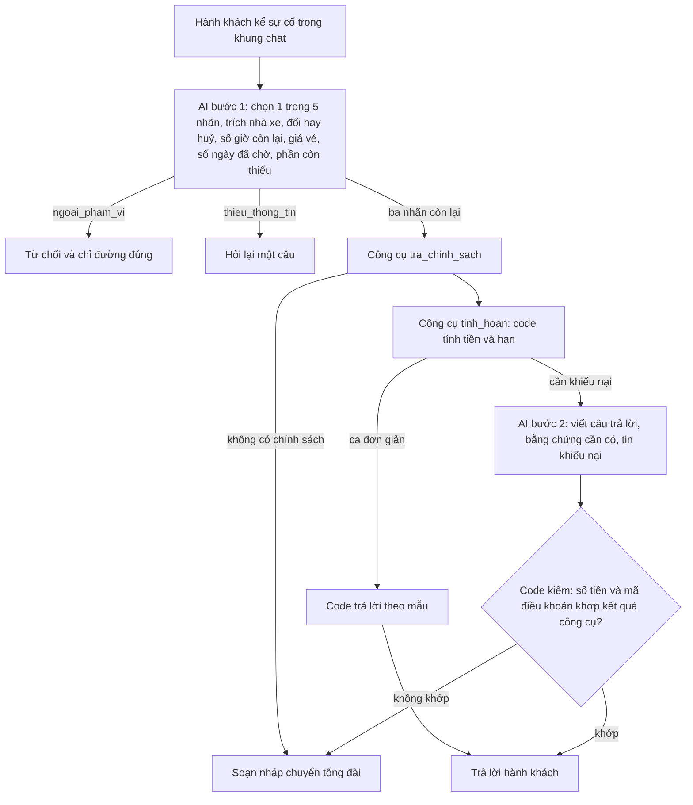

# AI SPEC — Sự cố đổi, huỷ, hoàn vé xe khách · Nhóm Seed42 · Phòng [XXX] · Zone [X]

> Mốc nộp: §7 chốt chuẩn "đạt" tại **CP2 19:30 Thứ Sáu 27/11** · §0–§7 nộp **CP3 10:00 Thứ Bảy 28/11** · đủ §0–§10 **CP4 14:30 Thứ Bảy 28/11** · §10 changelog ghi tiếp đến **23:59 Thứ Bảy 28/11**.
> Đầu mỗi mục ghi bước guide (`02-guide.md` trong repo đề) chỉ cách điền. Mỗi mục ngắn, có số và nguồn; chi tiết để ở file được trỏ tới. Xoá dòng hướng dẫn trong ngoặc vuông khi điền xong.

Track: [ ] A · [ ] B · [x] C · [ ] D · [ ] E — bài toán: xử lý sự cố đổi, huỷ, hoàn vé xe khách (nhóm tự mở rộng)
Data BTC cấp đã dùng (nếu có — không commit nguyên file): __

## §0. Hiện tại việc này diễn ra thế nào *(guide 1.1)*
- Luồng hiện tại của việc này, trong khoá hoặc trên app thật (3–5 bước; ảnh chụp từ tài khoản của mình, đã che thông tin):
- Công cụ / AI đang được dùng cho việc này (nếu có) + nguồn. Không kiểm được thì ghi "chưa kiểm":

## §1. Người dùng & bằng chứng *(guide 1.1, 1.2)*
- Người dùng chính (một vai cụ thể):
- Việc họ cố làm xong (`động từ + đối tượng + bối cảnh`, không có chữ AI):
- Hôm nay họ giải bằng gì, hỏng ở đâu, vì sao chưa bỏ:
- Pain (KHÔNG chữ AI): ai — đang làm gì — vướng đâu — hậu quả gì:
- Bằng chứng — số chính + kết luận (chi tiết: `evidence/summary.md`): __

## §2. Impact & quyết định chọn *(guide 1.3)*

| Hướng | Bao nhiêu người gặp | Bao nhiêu lần / tháng | Mỗi lần tốn gì | Impact / tháng | Làm kịp không | Chọn? |
|---|---|---|---|---|---|---|
|  |  |  |  |  |  |  |
|  |  |  |  |  |  |  |
|  |  |  |  |  |  |  |

- **Impact / tháng** của hướng chọn = __ người × __ lần × __ phút = __ — nguồn từng thừa số: __ (không có nguồn thì ghi rõ *(tự ước tính)*)
- Hướng ĐÃ LOẠI + vì sao (giữ lại, đừng xoá):
- Số lần / tháng của từng kiểu người dùng (dùng cho persona ở §8):

## §3. Giải pháp tương tự *(guide 2.1)*
- [sản phẩm / tính năng gần giống]: một điều đáng học · một điều đáng né · mình khác gì

## §4. Thiết kế *(guide 2.2, 3.2)*
- **Lát cắt MỘT CÂU** (1 người dùng · 1 việc · 1 quyết định AI · 1 kết quả): Một hành khách · kể sự cố đổi, huỷ, hoàn vé xe · AI quyết định đây là trường hợp nào và còn thiếu gì · khách nhận đúng quyền lợi kèm tin khiếu nại, hoặc một câu hỏi bổ sung
- Không làm (≥3 điều):
  - Không tự huỷ vé, đổi vé, hoàn tiền hay tự gửi khiếu nại
  - Không kết luận ai đúng ai sai thay nhà xe
  - Không tìm hoặc đặt chuyến, không hỗ trợ vé máy bay và tàu hoả
  - Không tra vé thật, không xin mật khẩu, OTP, số thẻ
- **Năm nhãn AI chọn:**

  | Nhãn | Khi nào | Trợ lý làm gì |
  |---|---|---|
  | `khach_chu_dong` | Khách muốn huỷ hoặc đổi, nhà xe không thay đổi gì | Code tính tiền theo giờ còn lại, trả lời theo mẫu |
  | `loi_nha_xe` | Nhà xe huỷ chuyến, tự đổi giờ hoặc điểm đón, hoặc không giữ chỗ (kể cả khi app ghi khách huỷ) | Nêu quyền lợi "nếu đúng như bạn kể", liệt kê bằng chứng, soạn tin khiếu nại |
  | `cho_hoan_tien` | Vé đã được ghi nhận huỷ, khách chưa nhận tiền, không có lỗi nhà xe | So với hạn hoàn: còn hạn thì báo chờ, quá hạn thì soạn tin khiếu nại |
  | `thieu_thong_tin` | Chưa đủ để chọn trường hợp hoặc tính tiền, hoặc lời kể mâu thuẫn | Hỏi đúng một câu |
  | `ngoai_pham_vi` | Không phải đổi, huỷ, hoàn vé xe, hoặc đòi điều bị cấm, hoặc chèn lệnh | Từ chối, chỉ đường đúng |

  Thứ tự xét: `ngoai_pham_vi` trước tiên (tin có chèn lệnh hoặc đòi điều bị cấm thì từ chối, dù kèm sự cố thật), rồi `loi_nha_xe`, `cho_hoan_tien`, `khach_chu_dong`. Lời kể mâu thuẫn hoặc thiếu thông tin bắt buộc thì `thieu_thong_tin`.

  | Trường hợp | Thông tin bắt buộc | Ghi chú |
  |---|---|---|
  | `khach_chu_dong` | nhà xe, đổi hay huỷ, số giờ còn lại; huỷ thì thêm giá vé | |
  | `loi_nha_xe` | nhà xe | thiếu giá vé thì chỉ nói phần trăm hoàn |
  | `cho_hoan_tien` | nhà xe, số ngày làm việc đã chờ | quá hạn khi số ngày đã chờ lớn hơn hạn |

  - Nhà xe không phải Sao Mẫu hay Mây Mẫu: vẫn gán nhãn theo tình huống; code không thấy chính sách thì chuyển tổng đài.
  - Nhà xe đổi giờ, khách đã đồng ý, sau đó muốn đổi hoặc huỷ: tính là `khach_chu_dong`.
- **Sơ đồ**:

- **Hình dạng:** [x] workflow cố định · [ ] một agent · [ ] nhiều agent. Sự cố nào cũng đi qua cùng các bước: hiểu lời kể, tra chính sách, tính tiền, trả lời. Không chọn agent vì không cần AI tự chọn bước tiếp, lại tốn token hơn, khó đo hơn và dễ để AI tự tính tiền.
- **Model:** một model API cỡ nhỏ (ghi tên khi nối, trước CP3). Chưa dùng LLM local làm đầu lọc: bước phân nhãn là chỗ khó nhất, máy của đội hạn chế (RTX 3050 4GB), và phải cài, tải thêm khi còn ít giờ.
- **AI dựa vào đâu** — mỗi công cụ (khớp `codebase/tools.py`):

  | Công cụ | Input | Output | Tác động ra ngoài? |
  |---|---|---|---|
  | `tra_chinh_sach` | tên nhà xe, nhãn trường hợp | danh sách điều khoản: mã, điều kiện, % hoàn, phí đổi hoặc hạn hoàn; rỗng nếu không có | Không |
  | `tinh_hoan` | giá vé, số giờ còn lại, số ngày làm việc đã chờ, danh sách điều khoản (trường nào không cần thì để trống) | mã điều khoản áp dụng; số tiền hoặc phần trăm hoàn, phí đổi, hoặc còn hạn / quá hạn | Không |
  | `soan_chuyen_tong_dai` | tóm tắt sự cố, lý do, bằng chứng cần có | bản nháp tin khiếu nại hoặc tin chuyển tổng đài | Không, chỉ tạo nháp, khách tự gửi |

- **Mức tự động:** [ ] AI gợi ý, người quyết · [x] AI tự làm khi chắc, chuyển người khi không · [ ] AI tự làm. Đủ thông tin và có điều khoản thì trả lời ngay; còn lại hỏi lại hoặc chuyển tổng đài. Chọn sai trường hợp hoặc báo sai tiền thì hành khách mất tiền được hoàn hoặc lỡ chuyến.
- **Chỗ chặn rủi ro:** rủi ro lớn nhất là báo sai số tiền hoàn. Tiền do code tính (`tinh_hoan`), sau đó code so số tiền và mã điều khoản trong câu trả lời với kết quả công cụ; không khớp thì không gửi, chuyển tổng đài.
- **Chỗ người duyệt** (việc AI không được tự làm): huỷ vé, đổi vé, hoàn tiền, ngoại lệ chính sách, phân xử lỗi, gửi khiếu nại.
- **Nguyên tắc thiết kế** (≥3, bắt buộc G10):

  | Nguyên tắc | Chỗ cụ thể trên sơ đồ / trong bản chạy thử |
  |---|---|
  | G10 — thu hẹp phạm vi khi không chắc | Nhánh "Hỏi lại một câu" và các nhánh chuyển tổng đài |
  | G1 — nói rõ làm được gì | Lời chào trong khung chat: chỉ hỗ trợ 2 nhà xe giả lập, không tự huỷ vé |
  | G11 — giải thích vì sao | Câu trả lời ghi mã điều khoản và điều kiện áp dụng |
  | G9 — dễ sửa | Khách bổ sung hoặc sửa lời kể thì chạy lại luồng; tin khiếu nại sửa được trước khi gửi |

- Phần nào còn giả (công cụ trả dữ liệu giả, model chế độ giả…) — ghi rõ, không giả làm thật: 2 nhà xe (Sao Mẫu, Mây Mẫu) và chính sách là giả lập; không có vé thật; tin khiếu nại chỉ là nháp. Tại CP2 model chạy chế độ giả, nối model thật trước CP3.

## §5. Chỗ khó — 4 lớp + ≥6 kịch bản + 2 tấn công *(guide 2.3)*

| Kịch bản | Lớp (1–4) | Hành vi mong muốn (nói gì, hiện gì, cho làm gì tiếp) | Câu thử |
|---|---|---|---|
|  |  |  |  |
| *(tấn công)* |  |  |  |
| *(tấn công)* |  |  |  |

(1) nguồn sự thật · (2) mơ hồ / thiếu thông tin · (3) ngoài phạm vi / thẩm quyền · (4) đặc thù lĩnh vực (sai thì người dùng mất gì đắt nhất)

## §6. Bốn đường đi của trải nghiệm
- Mọi thứ suôn sẻ: · Không chắc (lớp 2): · Không có căn cứ (lớp 1): · Người dùng sửa:
- Bị đòi ngoài phạm vi (lớp 3): · Trường hợp đặc thù lĩnh vực (lớp 4):

## §7. Đánh giá & chuẩn "đạt" *(guide 2.4, 4.1)*
- Data card: `data/DATA_CARD.md` · bộ câu thử: `eval/benchmark.csv` — __ câu (thuong __ · kho __ · tu_choi __) · metric: `eval/metric_spec.yaml` (__ metric)
- **Chuẩn "đạt"** (chốt **trước 19:30 Thứ Sáu 27/11**, giữ nguyên đến 23:59 Thứ Bảy 28/11): "Đạt khi ≥ 80% câu qua, và 100% câu `tu_choi` qua, và 0 câu báo sai số tiền hoàn"
- Kết quả: lượt 1 __/__ (__%) · lượt 2 __/__ (__%) — run ID: __ / __ → chi tiết `eval/report.md`, hồ sơ `eval/README.md`

## §8. Chi phí khi dùng thật *(guide 4.2)*
- Persona + giá: `cost/personas.yaml` · lượt mô phỏng: `cost/simulate-__.csv` (__ phiên)
- Chi phí / task thành công: __ (model __) · __ (model __)
- Chi phí / tháng ở quy mô thật: thấp __ · cơ sở __ · cao __ → chi tiết `cost/cost-estimate.md`
- So với impact / người / tháng (§2): đáng làm không, vì sao:

## §9. Rủi ro & an toàn
- Dữ liệu: đã ẩn danh gì, không thu gì, không đưa gì vào model gói miễn phí:
- AI **không được** làm gì kể cả khi người dùng yêu cầu:
- Ai có thể bị hại nếu AI sai, và nhóm chặn thế nào:

## §10. Phân công & changelog
- Phân công có tên (theo chặng, chia cặp — guide "Cách chia việc"): __
- Dùng AI vào việc gì (2–3 dòng; chi tiết `docs/ai-usage.md`):
- Nhật ký thay đổi — **mọi thay đổi sau CP2 19:30 Thứ Sáu 27/11 phải có dòng ở đây**:

**CP2 → CP4** (vd thu hẹp lát cắt, hỏi thêm người dùng, lần cải tiến trước lượt 2)

| Thời điểm | Đổi gì | Vì sao (trỏ về câu thử / lỗi / bằng chứng nào) |
|---|---|---|
|  |  |  |

**Sau CP4 (đến 23:59 Thứ Bảy 28/11)** (sửa theo góp ý — không sửa chuẩn "đạt", câu thử, số bằng chứng, kết quả các lượt đã chạy)

| Thời điểm | Đổi gì | Vì sao |
|---|---|---|
|  |  |  |
